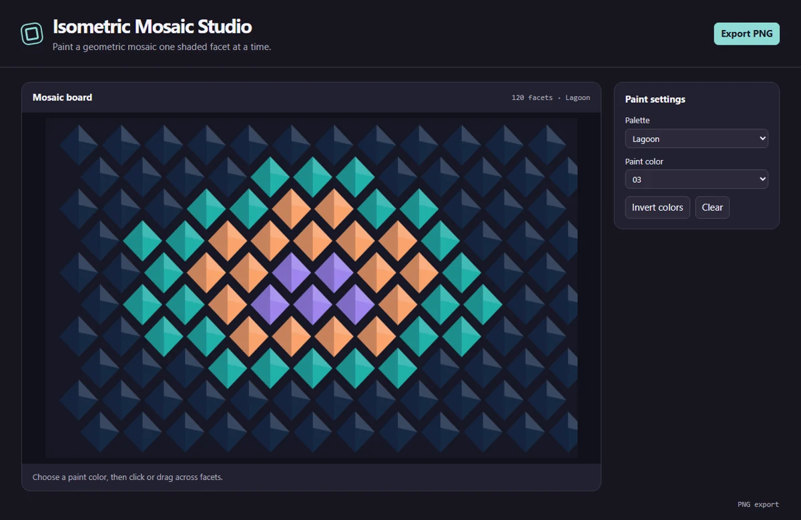

# Isometric Mosaic Studio

Paint a grid of shaded geometric facets with curated palettes, color inversion, and PNG export.



## Run locally

Install Node.js 24 and npm. From the repository directory, run:

```sh
npm ci
npm start
```

The first command installs the locked dependencies. The second opens the desktop window and may download the pinned Electron runtime on first launch. All artwork is processed locally. The app requires no account or API key.

## Use the app

Pick a palette and one of its five paint colors. Click or drag across facets to recolor them. Invert remaps each color to the opposite palette index. Clear resets all facets to the first color. Export the 1000 × 640 composition as PNG.

Edits are held in memory until the app closes.

## Project layout

- `main.cjs` creates the Electron window and handles native export dialogs.
- `preload.cjs` exposes the small set of desktop operations available to the renderer.
- `app.js` manages shared controls, canvas input, and export encoding.
- `tool.js` contains this app's drawing and editing logic.

## Verify

```sh
npm test
```

The test starts an offscreen Electron window, changes a real editor control, verifies the resulting artwork, and checks the encoded export. On a headless Linux host with Xvfb, use `xvfb-run -a npm test`.
